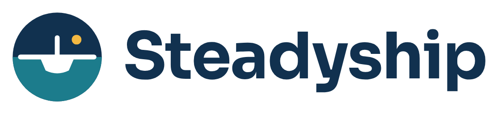

  <picture>
    <source media="(prefers-color-scheme: dark)" srcset="docs/brand/logo-dark.png">
    
  </picture>

An engineer in the conversation for non-technical people building business
software with AI. Steadyship is a Claude plugin: it asks what you don't know
to ask, judges what you can't judge, and gives prototypes a path to software a
business can run on. Why it exists, in plain words: [Why Steadyship](docs/why-steadyship.md).
Website: https://steadyship-zeta.vercel.app (built from `site/`, see below).

## Quick start

About ten minutes, and no terminal beyond a one-off setup line. Pick the page
for your setup and follow it top to bottom. New here? Start with
[Why Steadyship](docs/why-steadyship.md).

| Your computer | You use | Page |
|---|---|---|
| Windows | Claude desktop app | [Windows, Claude desktop](docs/quickstart/windows-claude-desktop.md) |
| Windows | Claude Code in a terminal | [Windows, Claude Code](docs/quickstart/windows-claude-code.md) |
| Mac | Claude desktop app | [Mac, Claude desktop](docs/quickstart/mac-claude-desktop.md) |
| Mac or Linux | Claude Code in a terminal | [Mac or Linux, Claude Code](docs/quickstart/mac-linux-claude-code.md) |

Every page has the same five steps: get the computer ready, add the plugin,
set it up for your business, use it (the same handful of sentences on every
setup: see your apps, review one, build, promote), and, if you have no apps
to hand, try the demo business. Only the first two differ by setup.

## What you get

- A repository of your own, self-contained: it works even without the plugin.
- A status check: what apps you have, what each is for, what is at risk.
- One prompt, "Check this computer": in about a minute, can it get online,
  read the shared drive, open one of your apps? Each a plain pass or fail,
  written down so nobody has to wonder again.
- An assessment of each app, written into `docs/assessment/`, from prototype
  to something the business can run on.
- Reviews, and the questions an engineer would ask before a change is built,
  with the answers recorded in `docs/context/decisions.md`.
- Prototypes built exactly as asked. When someone else is
  about to rely on one, "Promote the [app name]" audits it, asks a few questions
  about the business, and rebuilds it unattended to the engineering
  standard with its behaviour pinned. Before that, two ten-minute
  conversations write down the business's data and its security, the two
  things that are expensive to change later. "finish" checks and lands a
  change you made yourself.

## For developers

- `plugin/` is the Claude plugin: `skills/` (`steadyship-init`, `-demo`,
  `-status`, `-check`, `-assess`, `-review`, `-ask`, `-next`, `-data`,
  `-security`, `-promote`, `-finish`), `standard/` (the bar and the landing
  routine), the scaffolder
  `scripts/init.sh`, `templates/` for the generated customer repository, and
  `demo/` (the mock customer, see `plugin/demo/README.md`).
- `.claude-plugin/marketplace.json` makes this repository the plugin
  marketplace.
- `scripts/validate.sh` runs every product check CI runs; `STEADYSHIP_FULL=1`
  adds the generated repository's Playwright smoke test.
- `tests/test-init.sh` generates a customer repository and checks it works.
- `site/` is the website (Astro, deployed to Vercel on every push to `main`). It
  renders `docs/why-steadyship.md` and `docs/quickstart/*.md` directly, so edit
  those files, not the site, to change what it says. `cd site && npm install &&
  npm run dev` to preview.
- `tests/judgement/` is the judgement eval harness (assess/ask/review on Demo
  Boatworks, with and without the plugin): `tests/judgement/run.sh`, results
  in `docs/judgement-spike.md`. It costs money and minutes, so it is not in
  `scripts/validate.sh` or CI.
- `scripts/package-plugin.sh` builds the upload zip; `scripts/setup.sh` and
  `scripts/setup-windows.ps1` are the end-user setup scripts the quick-start
  pages use;
  `scripts/demo-regenerate.sh` rebuilds the standing demo repository.
- Releasing: bump `version` in `plugin/.claude-plugin/plugin.json`, commit,
  then tag `vX.Y.Z` and push the tag. The `release` workflow attaches the zip
  to a GitHub release, which the setup scripts download.
- `docs/` holds `quickstart/` (one page per setup), `why-steadyship.md`
  (for end users), `proposal-v0.1.md`
  (the full concept proposal: problem, product, architecture, pilot plan),
  rehearsal notes (`rehearsal.md`, `rehearsal-windows-vm.md`), the
  field-test plan and guide, and the logo files in `docs/brand/`.

Each business gets its own repository, generated by `steadyship-init` from
`plugin/templates/`, owned by the business, and self-contained.

## Licence

Apache License 2.0, see `LICENSE`.
